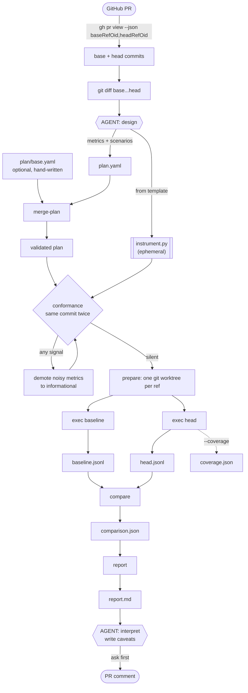
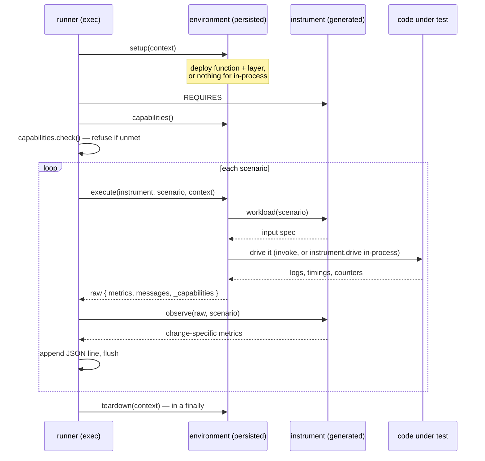

# Design: agent-led PR benchmarking

## The problem

Reviewing a diff tells you whether the code looks right. It does not tell you what the code *does* —
whether a fix actually fixes the thing, and what it costs. Answering that needs a benchmark designed
for one specific change, run against two specific commits, and the honest part is harder than the
measuring: a benchmark that returns a plausible wrong number is worse than no benchmark, because
someone will act on it.

That shaped every decision here. The harness is built less to produce numbers than to refuse to
produce numbers it cannot stand behind.

## Core principle: the agent designs, the runner measures

An AI agent decides **what to measure and what it means**. The runner decides **nothing**. There is no
model call anywhere in `runner/` or `environments/`.

This is not fastidiousness. A model choosing timing, sampling or scenario shape *between* the baseline
and head runs would make the two incomparable, and the resulting delta would be an artefact of the
model's variance rather than of the change. So the plan and the instrument are generated **once** and
used for both refs, and everything downstream is deterministic arithmetic.

| Agent | Runner |
|---|---|
| Which metrics matter for this diff | How a scenario is executed |
| Which scenarios reach the new branches | Metric accounting |
| The instrument that measures them | Outcome categorisation, delta arithmetic |
| The caveats, written after reading raw numbers | Capability assertions, conformance gate |
| Whether to publish | Markdown rendering |

## The two halves: persisted vs. generated

The split that matters is **infrastructure vs. instrumentation**, not plan vs. code.

- **Environments are persisted** (`benchmarks/environments/`). Where a benchmark runs. A team
  provisions one once and reuses it across many PRs. Change-agnostic by construction: `lambda_python`
  knows how to deploy a Python Lambda and read CloudWatch, and nothing about UDP.
- **Instruments are generated and discarded** (`results/<runid>/instrument.py`). What one diff does.
  A datagram counter written for one PR has no business accumulating in a shared harness, so it is
  written into the run's sandbox, used, and thrown away. Never committed, never reused.

The obvious objection: if the instrument is discarded, so is everything learned while writing it. Two
mechanisms keep the knowledge on the persisted side.

**Capabilities.** Environments publish what they can represent; instruments declare what they need.
`local_process` on macOS honestly reports `udp_datagram_bytes: 9216`, and an instrument requiring
65,507 is refused rather than run. This exists because the first version silently measured the host
instead of the code and reported `ok` with 0% delivery on *both* refs.

**Conformance.** A generated instrument is assumed wrong until it measures one commit **twice** with no
signal. Anything non-neutral means it is measuring noise or measuring the harness.

## Dataflow

The two `exec` runs are identical in everything except which worktree's source is on `sys.path`. That
is the whole experiment: same plan, same instrument, same environment, different commit.

## Inside one scenario

The environment owns execution and produces *raw observations*. The instrument says what they mean.
Keeping those separable is what makes a generated instrument reviewable — the risky half is small and
has no side effects.

`flush` per scenario is deliberate: an interrupted run keeps everything that finished, and `teardown`
sits in a `finally` so an exception cannot leave a deployed function running.

## Correctness mechanisms

**Outcome categories before arithmetic.** A percentage delta against a baseline that could not run is
meaningless. Scenarios are sorted first — `comparable`, `newly-working`, `newly-broken`, `both-failed`,
`missing` — and only comparable ones get deltas. In this PR the baseline fails with `EMSGSIZE` on every
oversized scenario, so eight of eleven are *newly working*, reported as such rather than as an infinite
improvement over a crash.

**Noise threshold.** Relative changes under 5% are neutral, so the report does not narrate drift as a
win.

**Directions, including `informational`.** A metric whose movement is not inherently good or bad carries
no verdict. Conformance forces metrics into this category when they prove unstable.

**Verdicts only where supported.** Post-conformance, this PR's in-process report shows delivery going
0% → 100% on a truncation scenario and still refuses to call it an improvement, because that metric was
shown unreliable in that environment.

## Why the safeguards exist

Each mechanism above was added after a measurement lied. They are recorded here rather than in a gap
tracker because they are not gaps — they are the reasons the persisted code looks the way it does.

**The host can silently be the wrong environment.** macOS defaults `net.inet.udp.maxdgram` to 9216
bytes, so every datagram the splitter produces fails with `EMSGSIZE` regardless of the code under
test. The first run reported `ok` with 0% delivery on *both* refs — a plausible-looking result that
was purely the host. Hence `local_process` publishes `udp_datagram_bytes` from a binary-search probe,
and refuses an instrument requiring more.

**A stand-in receiver bounds the number it is supposed to measure.** The in-process delivery rate came
out ~5% against the PR's reported 89–98%. Two causes: `net.core.rmem_max` silently caps `SO_RCVBUF`
(8 MB requested, 425,984 granted), and the sink is a single Python thread that cannot drain 50 × 48 KB
fast enough — delivery stayed ~5% even with 8.76 datagrams of headroom. Hence
`real_telemetry_backend: false`, and `rcvbuf_datagram_headroom` is recorded so a reader can tell a
result from an artefact.

**Metrics that look meaningful can be noise.** Conformance found `delivery_rate_pct` swinging 9.2 →
4.8 on identical code, and `export_latency_p99_ms`, `cpu_total_s` and `peak_rss_bytes` all exceeding
the 5% threshold run to run. Before the gate existed, a report called one of those a 26.9%
improvement. Hence the gate, and hence `informational` as a first-class direction.

**Aggregated telemetry can double-count.** Application Signals publishes the same metric at several
dimension granularities; summing `Latency` `SampleCount` across every set `ListMetrics` returned gave
11 invocations a request count of 33. That silently clamped a shortfall metric to zero, which would
have "confirmed" a hypothesis regardless of the truth. Dimension sets are now reduced with `max()`,
and `red_dimension_sets` records how many were found.

**Environmental failures look like results.** The layer build needs ECR Public authentication (`403`
without it, `429` under load — the same registry problem behind this PR's red CI) and ~5 GB free in
the Docker VM. `layer.py` detects both in the build output and prints the remedy rather than failing
opaquely. First build 190s; the second ref 24s on cache.

**Measurement conditions have to be pinned.** Lambda CPU scales with configured memory, so memory
size, runtime and architecture are fixed across refs and cold starts are warmed out and reported
separately. Application Signals aggregates on 1-minute boundaries with ingestion lag, so the settle
wait is an explicit parameter rather than a sleep buried in the code.

One more reason this exists at all: AWS DevOps Agent reviews the diff but will not benchmark it, and
its automated PR review is private-repository-only — so for a public fork there was no path to
measured before/after behaviour on a PR.

## Trust boundaries

- The in-process environment binds loopback only. Nothing listens on an external interface.
- `lambda_python` creates a function, layer, role and log group named `udpbench-<run>-<ref>-*`.
  **No API Gateway and no public endpoint** — the function is driven by `lambda:Invoke`. If HTTP-level
  throughput is ever needed, the decided posture is `AWS_IAM` on the method.
- Teardown asserts the run prefix before every delete (`_assert_ours`), because the account holds
  unrelated stacks. `find_orphans()` lists leftovers if a run dies before teardown.
- The agent stops and asks before creating cloud resources, posting to GitHub, running a privileged
  container, or changing a host sysctl.

## Extension points

| To add | Do this | Never touch |
|---|---|---|
| A measurement for a new change | Generate an instrument from `templates/instrument_template.py` into the run dir, gate it with `conformance` | anything in the repo |
| A new place to run | A package under `environments/<name>/` exposing `ENVIRONMENT` with `capabilities()` and `execute()`, plus optional `setup`/`teardown` | `runner/` |

Scenario `params` are free-form and validated by the instrument, so a probe for a JVM heap fix or an
EC2 request path needs no schema change.

## What this deliberately does not do

- **No gating.** It reports; it does not block merges. The categories and verdicts are for humans.
- **No absolute performance claims from the in-process environment.** It publishes
  `real_telemetry_backend: false` precisely so nobody reads its delivery rate as a production number.
- **No reuse of instruments.** Tempting, and the whole point of the split is to resist it.
- **No HTTP-level throughput.** Dropped with API Gateway, to avoid standing up a public endpoint.

## Evidence

Verified against PR #1 (`59a7f29` → `bcf1bfd`):

- `conformance`: PASS, 11 scenarios, no signal between identical refs — after it forced
  `delivery_rate_pct` (9.2 vs 4.8 on identical code), `export_latency_p99_ms`, `cpu_total_s` and
  `peak_rss_bytes` to be demoted to informational.
- `local_process`: 8 newly-working, 2 comparable, 1 failed on both, 0 metric regressions. Branch
  coverage 69.7% of `_udp_span_payload.py`, 75% of `otlp_udp_exporter.py`.
- `lambda_python`: three real functions deployed and destroyed. Baseline logged 22 `EMSGSIZE` errors on
  an oversized batch, head none, costing ~18% throughput and ~13% p99.
- 15 unit tests over categorisation and delta arithmetic.

Known gaps, recorded in [`GAPS.md`](GAPS.md): `lambda_python` has no conformance run behind it, so its
latency and throughput deltas are directional only; the EC2 runtime-metric source is unbuilt; and no
example instrument ships on the branch, since generated instruments are gitignored by design.
